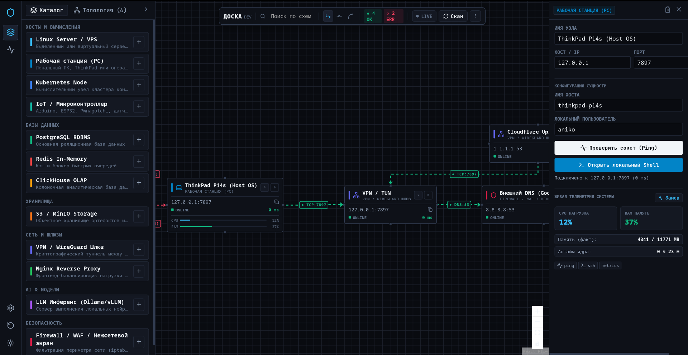
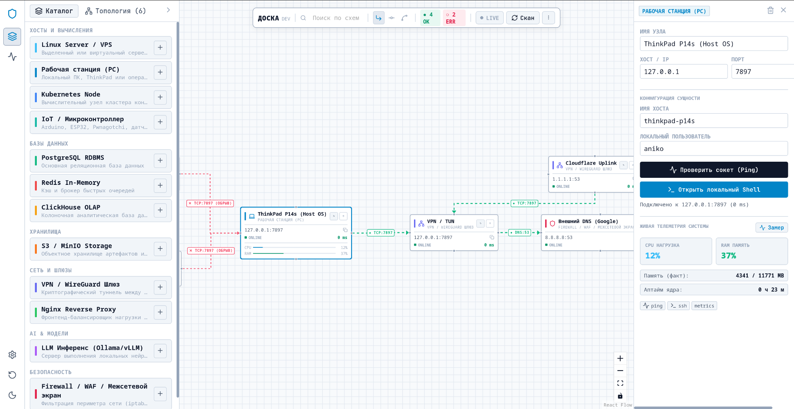

# 🌐 ДОСКА (DOSCA)
### Диспетчер Оперативного Сетевого Контроля и Аудита
**Distributed Operations, Security & Control Architecture**

Локально-ориентированный (Local-First) программный комплекс для интерактивного картирования, реактивной диагностики доступности узлов и аудита внутренней IT-инфраструктуры в реальном времени.

---

## 📸 Интерфейс системы

  
<b>Тёмная тема</b>

  
    
  
<b>Светлая инженерная тема</b>

  

---

## 🛠️ Текущий реализованный функционал

Проект находится в активной разработке. На данный момент полностью функционируют следующие подсистемы:

### 1. Инженерный топологический холст
* **Схемотехнический рендеринг:** Построение графа с жесткой координатной привязкой компонентов к сетке (Snap-to-Grid) с шагом 16 пикселей.
* **Режимы трассировки связей:** Поддержка ортогональной разводки под 90° (`Step`), плавных скруглений (`SmoothStep`) и прямых линий.
* **Реактивная индикация каналов:** 
  * Активные соединения подсвечиваются с указанием протокола, порта и измеренного RTT (например, `TCP:7897`, `DNS:53`).
  * При недоступности порта или узла связь моментально трансформируется в алый пунктирный контур с маркером обрыва (например, `✕ TCP:7897 (ОБРЫВ)`).
* **Поддержка тем оформления:** Полноценное переключение между тёмной и светлой инженерной темами без перезагрузки холста.

### 2. Типизированный каталог узлов (Entities Catalog)
Интерфейс поддерживает быстрое добавление разнородных компонентов инфраструктуры по категориям:
* **Хосты и вычисления:** Linux Server / VPS, Рабочие станции (PC / ThinkPad), ноды Kubernetes, IoT и микроконтроллеры (ESP32 / Pwnagotchi / Arduino).
* **Базы данных:** PostgreSQL RDBMS, Redis In-Memory, ClickHouse OLAP.
* **Хранилища:** S3 / MinIO Object Storage.
* **Сеть и периметр:** VPN / WireGuard шлюзы, Nginx Reverse Proxy, Firewall / WAF.
* **AI-инференс:** Локальные LLM-эндпоинты (Ollama / vLLM).

### 3. Диагностическое ядро и сбор метрик (Rust Engine)
* **Асинхронный TCP-зонд:** Быстрая проверка доступности сокетов хостов с микросекундным замером задержки (RTT отклика).
* **Живая телеметрия системы:** Сбор метрик локального хоста в реальном времени (нагрузка CPU %, утилизация оперативной памяти `fact/total MB`, аптайм ядра ОС).
* **Быстрые сетевые действия:** Вызов точечного пинга сокета, запуск локального shell-терминала к целевому узлу.

### 4. Журнал событий сети (Audit Log)
* Встроенный нижний док аудита с фиксацией событий инфраструктуры в реальном времени:
  * Создание и удаление логических связей между нодами.
  * Логирование фонового опроса метрик хостов.
  * Управление состоянием фонового мониторинга (Pause / Resume / Live).

---

## 🧩 Архитектурный стек

* **Системный бэкенд:** `Rust` (асинхронный рантайм `Tokio`, сетевой стек сокетов, библиотека сбора системных метрик `sysinfo`).
* **Мост взаимодействия:** `Tauri v2 IPC` (бинарная/JSON сериализация вызовов между Rust-ядром и WebKitGTK).
* **Интерфейсный уровень:** `React 19`, `@xyflow/react` (кастомные узлы и алгоритмы трассировки рёбер), `Zustand` (локальное реактивное состояние топологии).
* **Принцип работы:** **100% Local-First** — программа полностью автономна, в коде отсутствуют внешние трекеры, аналитика и зависимость от сторонних облачных API.

---

## 🔒 Лицензия и авторские права

**Copyright © 2026 anikoexe. Все права защищены.**

Данный репозиторий носит исключительно демонстрационный характер.  
* Запрещается любое копирование, модификация, распространение, обратная разработка (декомпиляция) или коммерческое использование исходного кода, макетов и архитектурных концепций проекта без предварительного письменного согласия правообладателя.
